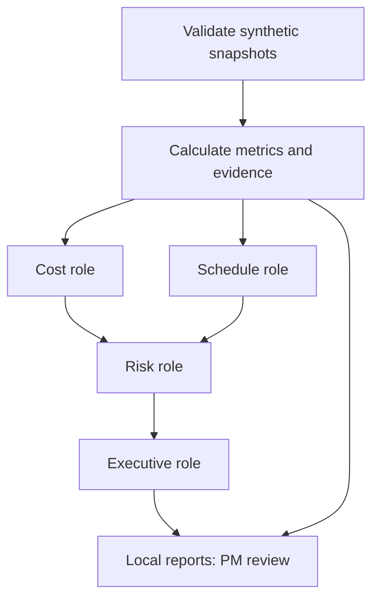

# Architecture and code walkthrough

The pilot separates trusted calculations from draft interpretation. Input dates,
values, and forecast finishes come from the supplied snapshot; “early warning”
means configured indicators, not predicted outcomes.

Cost and schedule run in two threads. Risk receives both outputs; executive
receives all three. The trace is recorded in cost, schedule, risk, executive order
regardless of thread completion order. A completed AI run makes four calls with
no autonomous planning loop or external tools. Offline uses the same role layout
with deterministic templates, not hidden model calls.

## Code map

| File | Responsibility | Important boundary |
| --- | --- | --- |
| `pmo.py` | CLI, JSON loading, size/duplicate-key checks, provenance, output protection | Validates before any paid call |
| `metrics.py` | Schema checks, financial and finish metrics, policy flags, trends | Source of numerical truth and RAG |
| `agents.py` | Four roles, copied handoffs, optional API adapter, output validation | Model prose cannot change evidence |
| `reporting.py` | JSON, Markdown, standalone HTML dashboard | Escapes untrusted text; no external assets |
| `data/sample_portfolio.json` | Current/prior synthetic snapshots and policy | No internal Mesa data |
| `tests/` | Meaningful unit/integration checks with fake AI | No live API dependency |

`import` loads reusable modules. `def` defines a function; calling its name with
parentheses executes it. A dictionary maps keys to values, while a list preserves
multiple items. `for` repeats work, `if` selects a branch, and `try/except` handles
failures. Type hints document intended values; validation enforces rules.

Follow the CLI in this order: load → validate → analyze → run roles → write reports.
Then read `analyze_portfolio` and trace one flag's `evidence_ids` into the evidence
map. In `run_agents`, inspect how concurrent cost/schedule results become risk
input. The model adapter converts Python objects to JSON with `json.dumps`; its
response must satisfy both a structural schema and project/evidence-ID checks.
Deep copies stop a backend mutating shared calculation objects.

## Failure and trust model

Invalid inputs stop before analysis or API calls. Undefined CPI/SPI remain null
and display as N/A; they are not silently replaced with healthy values. Agent
failures retain baseline analysis, discard partial role narratives, and produce
a failed-AI notice. Every completed result still says `REQUIRES_PM_REVIEW`.

Input SHA-256, generation timestamp, mode, model label, and filename support
run traceability. They do not certify source accuracy or prevent all tampering.
Evidence-ID validity proves a reference exists; it does not prove the prose
interprets it correctly. PM review must compare recommendations with cited values.

## Integration boundary

No Jira, Primavera P6, scheduling engine, database, authentication service, or
Mesa API is implemented. A later adapter should normalize an approved export to
the documented schema and preserve source lineage. It should not bypass input
validation or let model output write back to a project system.

Public business alignment: Mesa PMO service page, retrieved October 30, 2026:
https://www.mesainc.com/project-management-organization/
